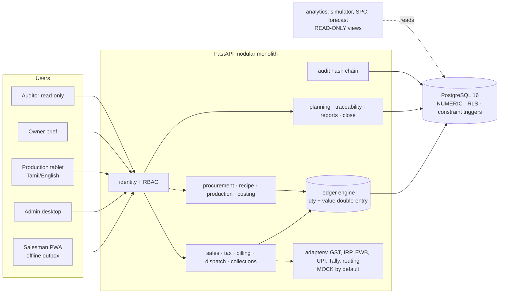

# AaharOS v2: Claude Code Master Prompt Pack
### NIT Trichy · Centre for Digital Infrastructure · Order-to-Audit System for a Small Food Manufacturer
**Tagline:** *Every gram traced. Every rupee explained.*

> **How to use this file.** Put it at `docs/MASTER_PACK.md` and the NIT brief at `docs/PROBLEM_STATEMENT.md`. Put `CLAUDE.md` at the repo root and `benchmark/expected_results.yaml` in place.
> Then, in Claude Code, run one prompt per session: *"Run MP04 from docs/MASTER_PACK.md."* Use `/clear` between prompts. Claude Code does **not** remember earlier sessions by itself. Its memory between sessions is `CLAUDE.md` plus `docs/PROGRESS.md`, which every prompt updates. That is the pack's continuity system.

---

## PART 0: Why this beats the other ~1,000 submissions

Most submissions will build an invoicing app with a stock table. A good one will match the benchmark table. NIT's brief says the production loop *"carries the most weight"*. Very few submissions will understand that loop the way a cost accountant, a food-safety officer and a factory owner do.

AaharOS wins on **insight density**: things the judges did not ask for but will recognise as correct and important.

### 0.1 The six "the judges didn't think of this" insights (all computed from NIT's own data)

| # | Insight | The number (verified) | Why it lands |
|---|---|---|---|
| 1 | **The production loss caused the sales shortage.** The two loops don't just meet at stock. They meet at money. | 12 of Distributor B's 32-packet shortage comes from this run's yield loss. At 200 good packets the shortage would have been 20. | It ties the two loops together causally, which is the brief's core idea taken one step further. |
| 2 | **Batch-standard variance hides the damaged pouches.** Comparing 194 pouches with the BOM's 200 looks *favourable* (−3%, not flagged). Compared with the standard for the actual good output (188), it is **+3.19%, flagged**. | Flexible ("driver-based") standards: ingredients are per batch, packaging is per good unit. | It is a real cost-accounting idea (flexible budget) that most CS students have never met. |
| 3 | **Where the ₹2.29/packet went.** Standard cost ₹28.85 → actual ₹31.14. The ₹431.20 total variance splits into yield loss **₹307.20**, oil overuse ₹70, flour price ₹45, pouch damage ₹15, carton −₹6. | The waterfall sums exactly to ₹431.20. | The owner learns that the 12 missing packets cost **4× more** than the oil spill everyone notices. |
| 4 | **You can make only ONE more batch.** After the run, oil (1.95 batches) and pouches (1.53 batches) are binding. Flour would allow 3. | Material Runway: making Distributor B's packets needs 1 batch, and after that you are blocked until oil and pouches are reordered. | It turns the "insufficient stock" step into a production-and-purchase decision. |
| 5 | **The valuation method changes the answer by 64 paise per packet.** WAC ₹31.14 · FIFO ₹30.90 · Last price ₹31.54. | A side-by-side sensitivity panel; WAC is the documented choice. | NIT says "pick and justify". We justify by showing the alternatives. |
| 6 | **2.4 kg of murukku is unaccounted for.** 40 kg packed mass was expected; 188 × 200 g = 37.6 kg made it into good packets. | Mass-balance view. Fill-weight sampling then separates over-filling (giveaway) from breakage and frying loss. | It is food-specific, measurable and actionable, and it uses Legal Metrology net-quantity checks the panel knows exist. |

### 0.2 The positioning sentence (use it in the README, the video and the interview)
> "Most billing apps record what was sold. AaharOS explains what was *made*, what it *cost*, where the profit *leaked*, and what to do *next*. Every number on every screen can be traced to the stock movement or document that produced it."

### 0.3 Strategy guardrails
- **Correctness first.** The brief: *"A smaller system that runs the benchmark correctly beats a larger one that does not."* No differentiator ships while any benchmark assertion is red.
- **Insight over features.** Five deep, connected features beat twenty shallow ones.
- **Honest claims.** Every claim in the README is backed by a command, a test or a visible workflow. ML is labelled; mocks are labelled; synthetic data is labelled.
- **Interview-proof design.** The data model makes the likely live changes (500 g pack, FIFO, new tax rate, tolerance) a config change, not a code change (see Part F).

---

## PART A: Product design

### A.1 Users and their one job

| Role | Device | Their one job | Signature screen |
|---|---|---|---|
| Salesman | Phone, weak network | Place an order in < 30 s | **One-Thumb Order** with *Repeat last order* |
| Factory admin | Desktop | Turn orders into correct invoices without overselling | **Order Inbox** with *Available to promise* and options |
| Production supervisor | Tablet on the floor | Record a batch exactly like the paper batch sheet | **Batch Card** (big keypad, Tamil/English, stock-impact preview) |
| Owner | Any | Know what to do today | **Morning Brief** (max 5 cards, "Today's 3 actions") |
| Accountant/Auditor | Desktop, read-only | Trust and export the month | **Month-End Close Cockpit** + Evidence Pack |

### A.2 Signature features (the "Big 7")
Build them in this order. Each grows out of data the core already captures.

1. **Benchmark Judge Mode.** One button (and `make benchmark`) replays NIT's 9 steps against a fresh BENCHMARK tenant. It shows a live 26-item scoreboard turning green, and each item links to its source record. A CI badge in the README shows the benchmark passing on every commit. *A judge comparing 1,000 repos can verify yours in 30 seconds.*
2. **Where Profit Leaks.** The variance waterfall (standard → actual), driver-based flexible standards, the link from lost output to lost sales, and evidence links on every card. Recommendations are phrased as hypotheses to check, never as asserted causes.
3. **Explain This Number.** Every figure has an ⓘ that opens its formula and inputs. Each input links to its source document. Backed by a backend `Explained<T>` type (Part B.6).
4. **Material Runway & Batch Planner.** "To fulfil pending orders, make 1 batch. After it, oil and pouches block a second batch. Reorder ≥ X L oil and ≥ Y pouches." It is a small integer optimisation over pending orders, finished goods, the recipe and stock. It recommends; humans approve.
5. **Trace This Packet + Recall Simulator.** Lot → run → recipe version → raw lots → dispatches → customers, in both directions. For example, Retailer A received 50 packets from the opening lot and 100 from batch B-001.
6. **Shelf Freshness Radar.** We know which batch went to which shop and when, and the shelf life of each. The salesman's app warns: "Retailer C probably holds 40 packets from B-014 that expire in 9 days. Rotate or offer a scheme." This cuts expiry returns, credit notes and food waste. No other submission will have this.
7. **Month-End Close Cockpit.** A readiness checklist covers unposted runs, uninvoiced dispatches, unallocated payments, open count differences, the period lock and the GST summary tie-out. One click then produces the auditor **Evidence Pack**: reports, the ledger CSV, the audit-chain verification and the assumptions. The same data produces a **bank stock & book-debts statement** for the factory's cash-credit limit.

### A.3 Food-industry intelligence (credibility multipliers, small effort each)
- **FSSAI licence number on every invoice and receipt.** FSSAI has required food businesses to print their 14-digit licence/registration number on invoices since October 2021 (GST e-way bills are exempt). Config field, DEMO value.
- **Batch label data:** lot, manufacture date, best-before, net quantity, MRP. The label/QR payload is generated from the run.
- **Used cooking oil (RUCO) log.** FSSAI caps total polar compounds (TPC) at 25%. Businesses frying with more than 50 L/day must keep oil-usage records and dispose of used oil through authorised agencies. AaharOS logs oil top-ups and discards per frying session and supports an optional TPC reading. This also explains part of the "+0.5 L" oil variance (absorption vs top-up).
- **Net-quantity (fill-weight) sampling.** The supervisor weighs n sample packets per batch. The system estimates giveaway (overfill grams × packets) and checks short-fill against a configurable tolerance table under the Legal Metrology (Packaged Commodities) Rules, 2011. **Do not hard-code tolerance values. Load them from config with a "verify" note.**
- **Effective-dated GST.** The brief's 5% assumption matches the post-22-September-2025 rate for pre-packaged namkeen/mixture (previously 12%). The tax engine is effective-dated, so an invoice dated before that would compute at the old configured rate. That is a strong one-minute interview demonstration. HSN stays an accountant-verified config field (namkeen is commonly classified under 2106 90).

### A.4 India Digital Public Infrastructure (DPI) readiness (the issuing body is the *Centre for Digital Infrastructure*)
All of these are **adapters with mock implementations and clear labels.** They show the architecture is ready without claiming live integration.

| DPI rail | What AaharOS does | Realistic rule encoded (configurable) |
|---|---|---|
| GST invoice (Rule 46) | Serial number unique per financial year, ≤ 16 chars, e.g. `AHR/26-27/000123` (exactly 16) | HSN digits per turnover band, place of supply |
| GSTR-1 / 3B | Export shaped to tables: 4A (B2B), 5 (B2CL), 7 (B2CS), 12 (HSN summary), 13 (documents) and 3B Table 3.1 | B2CL = inter-state supply to an unregistered buyer with invoice value > ₹1 lakh (since Aug 2024) |
| e-Invoice (IRP) | Mock IRN/QR payload. An applicability switch is driven by aggregate annual turnover | Mandatory if AATO > ₹5 crore in any FY since 2017-18 |
| e-Way Bill | Applicability check on dispatch; mock payload | Inter-state consignment value > ₹50,000. Distributor B (₹6,300) → **not required**, and the screen says why |
| UPI | Invoice PDF carries a UPI deep-link QR (`upi://pay?...&am=7875.00&tn=INV-no`) with a **DEMO, not payable** watermark | Collection reconciles on the invoice reference |
| MSME (Udyam) | Udyam no. on invoices; 45-day due-date clock in ageing | MSMED Act s.15 (15 days without a written agreement, up to 45 with one). The buyer's tax deduction is tied to timely payment: s.43B(h) of the 1961 Act, carried into the Income-tax Act, 2025 as s.37(2)(g). Reminder copy says "verify with your CA" |
| Tally | Tally-compatible XML/Excel voucher export | Export only; never a dependency |
| ONDC (future) | Catalogue export stub | Roadmap slide only |

### A.5 Money, transport, investment and social value (owner-language features)
- **Cost-to-Serve per customer** = delivery cost allocated + credit cost (outstanding × annual rate × days ÷ 365) + returns/expiry credit notes. A retailer can be "profitable" on margin and unprofitable after cost-to-serve.
- **Deal Desk.** When an admin or salesman proposes a special price, show the price floor (marginal cost + delivery cost + credit cost), the margin impact, and whether the deal beats leaving stock idle.
- **Delivery planning.** Group dispatch-ready orders into trips under a vehicle-capacity limit. Offer **backhaul matching**: "Your Karnataka trip passes Supplier S-03. Pick up flour on return and save ₹X freight." Include a minimum economic drop size per route.
- **Working-capital view:** inventory days + receivable days − payable days (cash conversion cycle), cash tied up in stock, receivables ageing.
- **Investment Case Builder.** It uses the factory's *own measured* data (yield loss ₹/month, giveaway grams, delivery km) to compute payback for a capex item such as a check-weigher, an auto-filler or a continuous fryer. It can include a capital subsidy line, e.g. PMFME (35% credit-linked, max ₹10 lakh per micro unit). **PMFME was extended to Sept 2026 with a further extension proposed, so the current status must be verified.**
- **Social value, measured not claimed:** kg of food waste avoided (expiry returns, yield), km and estimated CO₂ avoided (configurable factor), hours of month-end work saved, % of batches traceable within 1 minute, % of invoices collected within 45 days. Each metric has a formula and a baseline field.

---

## PART B: Architecture

### B.1 System view


**Why a modular monolith:** one deployable unit, one transaction boundary, simple to run with `docker compose up` and simple to explain live. Module boundaries are enforced with an import-linter contract, so modules could be split out later if needed.

**Stack justification (README, 3 sentences):** PostgreSQL gives exact NUMERIC arithmetic, real transactions and constraint triggers, so the ledger's correctness is enforced by the database, not only by app code. FastAPI with Pydantic and Python `Decimal` keep the money and tax logic typed and testable, and Python gives direct access to OR-Tools and the analytics stack. A React PWA covers phone, tablet and desktop from one codebase and supports offline order capture with no app-store dependency.

### B.2 The ledger: double-entry for kilograms
Every stock event is a **journal** with **lines**. Each line has `(item, location, lot, qty_base, value_paise)`. For each journal and item, `Σ qty = 0`. Virtual locations make the books balance:

`SUPPLIER · RAW_STORE · PACK_STORE · PRODUCTION (WIP) · FG_STORE · IN_TRANSIT · CUSTOMER · SCRAP · ADJUSTMENT · OPENING`

| Event | Lines (qty) |
|---|---|
| Purchase 60 kg flour | SUPPLIER −60 kg, RAW_STORE +60 kg |
| Issue to run | RAW_STORE −40 kg flour, PRODUCTION +40 kg flour (same for oil and spice) |
| Packaging consumed | PACK_STORE −194 pouches; PRODUCTION +188 (into good packs); SCRAP +6 (damaged) |
| Output | PRODUCTION −(bulk) ; FG_STORE +188 packets (lot B-001) |
| Dispatch | FG_STORE −150 (50 OPEN-LOT + 100 B-001), CUSTOMER +150 |
| Count difference | RAW_STORE −0.3 kg, ADJUSTMENT +0.3 kg (reason required, approver recorded) |

- A **balance** is `Σ lines` for a real location. `inventory_balances` is a projection updated in the same transaction and rebuildable at any time (`make integrity`).
- A **deferred constraint trigger** rejects any journal whose lines do not sum to zero per item. Conservation law 1 is therefore enforced by Postgres itself.
- **Value lines** run in parallel. The production run's value moves into finished goods, and variances post to explicit variance accounts. Value conservation (law 2): ₹5,855 = ₹3,114.36 (100 packets dispatched) + ₹2,740.64 (88 on hand). The "last unit absorbs rounding" rule keeps it exact.
- Why this design wins the interview: *"Opening + receipts − issues ± adjustments = closing"* holds **by construction**, the same way a trial balance always balances.

### B.3 Two-level BOM with driver-based lines (interview-proof)
```
RECIPE  "Murukku dough & fry" v3     → yields BULK murukku (kg), expected 40.0 kg per batch
  flour 40 kg · oil 10 L · spice 1.2 kg                (driver = PER_BATCH)
PACK SPEC  "Murukku 200 g"  v1       → consumes BULK 0.200 kg per good unit
  pouch_200g 1 per good unit · carton_20 1/20 per good unit (driver = PER_GOOD_UNIT)
PACK SPEC  "Murukku 500 g"  v1       → consumes BULK 0.500 kg per good unit (interview change = data only)
```
- One **production run** (one screen for the supervisor) = recipe execution + one or more pack lines. In the benchmark, 1 batch → 200 expected 200 g packs.
- Expected output per pack = (bulk allocated ÷ pack net weight). For 500 g: 40 kg → 80 packs. A mixed split (20 kg → 100 × 200 g + 20 kg → 40 × 500 g) needs no code change.
- `driver` makes flexible standards automatic: PER_BATCH lines are compared with the batch standard, PER_GOOD_UNIT lines with the standard for actual good output.
- Every run stores frozen copies of the recipe and pack spec it used (`*_snapshot` JSONB plus version id).

### B.4 Valuation and costing
- **Primary: perpetual moving weighted average (WAC)** per item. After the flour receipt: (100×42 + 60×45)/160 = **₹43.125/kg**. Justification: transparent, fits the brief's opening-plus-purchase scenario, stable for small factories, and recommended for fungible bulk inputs.
- **Strategy interface** `ValuationStrategy {WAC, FIFO, LAST}`. WAC posts to the books; the other two run in **sensitivity mode** for the comparison panel. Switching the policy for future periods is a governed config change with an ADR. History is never revalued.
- **Run cost** = Σ(actual issue qty × unit cost at issue) + direct run costs (labour, gas/power), stored as a snapshot. **Cost per good packet** = run cost ÷ good packets (188, not 200), because damaged and missing output earns nothing. ₹5,855 ÷ 188 = ₹31.143617 → shown as **₹31.14**.
- **Monthly overheads** (rent, fixed power, salaries) are allocated by a documented rule: **machine-hours by default, kg of bulk output as fallback**. Shown separately as "absorbed" so the owner can see marginal cost (for pricing decisions) and full cost (for inventory valuation).
- **Finished goods** are lot-valued (each run's lot carries its own unit cost) and dispatched FEFO. Opening FG lot = standard cost ₹28.85 (assumption A1).
- **Standard cost card** (versioned): standard quantities × standard rates (opening rates, assumption A2) → ₹28.85/packet.

### B.5 Variance engine (exact formulas)
```
Batch standard qty      = bom_qty × batch_multiplier                       (PER_BATCH lines)
Flexible standard qty   = bom_qty_per_good_unit × actual_good_units          (PER_GOOD_UNIT lines)
Usage variance %        = (actual − standard) / standard × 100       flag if |v| > tolerance (default 3%)
Yield variance %        = (good − expected) / expected × 100         → (188 − 200)/200 = −6.00%  FLAG
Oil                     = (10.5 − 10)/10 = +5.00%                                               FLAG
Pouch (flexible)        = (194 − 188)/188 = +3.19%  FLAG   [batch view −3.00%: within tolerance → shows why flexible matters]
Carton (flexible)       = (9 − 9.4)/9.4 = −4.26% favourable → info: 8 loose packets not cartoned
```
**Cost variance waterfall** (standard cost of 188 good = 188 × 28.85 = ₹5,423.80; actual ₹5,855.00):

| Driver | Formula | ₹ |
|---|---|---:|
| Yield loss | 12 × (batch-input standard ₹5,120 ÷ 200 = ₹25.60) | 307.20 U |
| Oil usage | 0.5 L × ₹140 | 70.00 U |
| Flour price | (43.125 − 42) × 40 kg | 45.00 U |
| Pouch damage | (194 − 188) × ₹2.50 | 15.00 U |
| Carton usage | (9 − 9.4) × ₹15 | 6.00 F |
| **Total** | | **431.20 U** |

**Demand-linked loss** = min(shortfall packets, unmet demand) × price. Here min(12, 32) × ₹50 = **₹600 revenue at risk**, labelled *potential*, not profit.

### B.6 `Explained<T>` provenance (the "Explain this number" backbone)
```python
@dataclass(frozen=True)
class Explained:
    value: Decimal
    unit: str                      # "INR", "INR/packet", "kg", "%"
    formula: str                   # "run_cost / good_packets"
    inputs: list["ExplainedInput"] # each: label, value, unit, source={"type":"production_run","id":"..."}
    method: str | None = None      # "WAC", "flexible standard", ...
```
Services return `Explained` for every KPI and variance. The API serialises it, and the React `<Num>` component renders the value plus an ⓘ popover. One mechanism covers owner screens, auditor drill-down and Judge Mode.

### B.7 Correctness under concurrency and weak networks
- **Reservations**: `SELECT … FOR UPDATE` on the item+location balance row inside the approval transaction. Available to promise = on_hand − reserved. A parallel test fires 2 approvals for the last packets and exactly one succeeds.
- **Invoice numbering**: per-org, per-FY counter row locked FOR UPDATE, so numbers are gapless and unique. Cancelled invoices keep their number; corrections are made by credit note.
- **Idempotency**: client-generated UUIDv7 `Idempotency-Key` on every write. The server stores key → response hash, and a replay returns the original response.
- **Offline outbox (PWA)**: Dexie/IndexedDB queue; states *Saved on phone → Sending → Received by factory → Approved*. "Received" is shown only after the server ACK. A captured price-list version travels with the order, and the admin sees stale-price warnings.
- **Period lock**: posting into a closed month is rejected; reopening requires an OWNER action and an audit reason.
- **Tenant isolation**: `organization_id` on every table plus Postgres **row-level security**, so cross-tenant reads are impossible even with a buggy query.
- **Tamper-evident audit**: `audit_log.hash = sha256(prev_hash ‖ canonical_json(row))`. `make integrity` verifies the chain. This gives blockchain-style evidence without a blockchain.

### B.8 Core data model (renderable ERD is produced in MP01)
`organizations, users, roles, permissions, memberships, salesman_customer_assignments, settings(effective-dated)`
`items(kind: RAW|PACK|BULK|FG), uoms, uom_conversions, pack_specs, recipes, recipe_versions, recipe_lines(driver), pack_spec_versions, pack_spec_lines(driver)`
`locations(kind real/virtual), lots(item, mfg, best_before, source), stock_journals(source_type, source_id, posted_at, period), stock_lines(qty_base, value_paise, lot, location), inventory_balances(projection), reservations`
`suppliers, purchase_receipts, purchase_receipt_lines, valuation_layers (FIFO sensitivity), item_cost_state (WAC)`
`production_runs(recipe_snapshot, pack_snapshot, status), run_issues, run_outputs(pack, good, damaged, scrap, reason), run_costs, fill_weight_samples, oil_sessions`
`standard_cost_cards, variance_results(run, line, kind, std, actual, pct, flagged, inr)`
`customers(state, gstin, credit_limit, msme_terms), price_lists(versioned), sales_orders, order_lines, order_status_history`
`tax_rules(hsn, rate, effective_from/to), invoices, invoice_lines, invoice_tax_lines, credit_notes, number_sequences(fy)`
`dispatches, dispatch_lines(lot), payments, payment_allocations`
`vehicles, trips, trip_stops, transport_costs`
`alerts, period_locks, audit_log(hash chain), idempotency_keys, outbox_events, export_jobs`

---

## PART C: The benchmark contract (26 assertions)

`benchmark/expected_results.yaml` is the oracle. The `make benchmark` scoreboard and Judge Mode both read it. Assertions 1–14 are NIT's; 15–26 are AaharOS extensions.

| # | Assertion | Expected |
|---|---|---|
| 1 | Flour closing | 120 kg |
| 2 | Oil closing | 19.5 L |
| 3 | Pouches closing | 306 |
| 4 | Finished goods after run | 238 packets |
| 5 | Finished goods after Retailer A dispatch | 88 packets |
| 6 | Yield variance | −6.00%, flagged |
| 7 | Oil variance | +5.00%, flagged |
| 8–11 | Retailer A invoice | ₹7,500.00 + ₹187.50 CGST + ₹187.50 SGST = ₹7,875.00 |
| 12 | Retailer A outstanding | ₹3,875.00 |
| 13 | Distributor B | shortage 32 flagged, no negative stock, order not invoiced |
| 14 | Distributor B tax regime | IGST 5% (₹300 if invoiced in full; ₹220 on a partial of 88) |
| 15 | Spice closing / cartons closing | 3.8 kg / 21 |
| 16 | Flour WAC after purchase | ₹43.125/kg |
| 17 | Run cost | ₹5,855.00 (materials ₹4,055 + labour ₹1,200 + gas ₹600) |
| 18 | Cost per good packet | ₹31.14 (WAC); sensitivity FIFO ₹30.90, LAST ₹31.54 |
| 19 | Variance waterfall | sums to ₹431.20 U (307.20 + 70 + 45 + 15 − 6) |
| 20 | Pouch flexible variance | +3.19%, flagged |
| 21 | FEFO dispatch to Retailer A | 50 from opening lot + 100 from B-001 |
| 22 | Value conservation of the run | ₹3,114.36 dispatched + ₹2,740.64 on hand = ₹5,855.00 |
| 23 | Shortage attribution | 12 of 32 caused by this run's yield loss |
| 24 | Material runway | max 1 more full batch; binding = oil, pouches |
| 25 | e-Way Bill applicability for B | not required (₹6,300 ≤ ₹50,000), reason shown |
| 26 | Integrity | 4 conservation laws hold; balances rebuild identically; audit chain valid |

**README "differences" note:** none of NIT's checks differ. Cost per packet is "our figure" (₹31.14, WAC, direct run costs, divided by 188 good packets). The pouch variance is reported in both views, with the reason.

---

## PART D: Data, ML and evaluation (honest and rigorous)

**Principle:** every ledger figure is deterministic. ML and statistics only *advise* (forecast, anomaly, risk). They read from views and never write to transactional tables.

### D.1 Three data layers
1. **Benchmark fixture**: NIT data only. Never used for training. Versioned, reset-safe.
2. **Factory Simulator (synthetic, planted truth)**: a seeded discrete-time simulation of 24 months: 1 factory, 10 salesmen, ~120 retailers/distributors (TN + KA + KL; real PIN-code centroids from the India Post open directory for realistic geography with fictional shops), 15 SKUs incl. 200 g/500 g/1 kg, 25 materials, 8 suppliers, recipe versions, lots and expiry, returns, delayed payments and trips.
   **Planted truths** (hidden parameters the analytics must rediscover):
   - Deepavali/Pongal/Onam demand uplift (festival dates live in a config table with source notes, not hard-coded).
   - Supplier S-05's flour lots yield 5% less (moisture).
   - Night-shift operator O-3 overuses oil by ~4%.
   - A retailer cluster on Route R-7 pays at about 60 days.
   - The 500 g SKU cannibalises the 200 g SKU at ~15%.
   - Injected data faults: 2% duplicate offline syncs, 0.5% unit-entry errors (g entered as kg).
3. **Public context (optional)**: data.gov.in daily mandi prices for rice/urad/groundnut as a *market reference signal* only. Raw copy, licence, download time, unit normalisation (₹/quintal → ₹/kg), quarantine of bad rows. It never touches book valuation.

### D.2 Preprocessing pipeline (`analytics/pipeline/`)
`raw → contract-validated (pandera schemas) → canonical units → de-duplicated (idempotency key, source doc) → chronology-checked (order ≤ invoice ≤ dispatch ≤ payment) → feature tables (SKU×week, customer×week, run-level)`
Every stage logs row counts in/out and the rejection reasons. A **datasheet** (`analytics/DATASHEET.md`) records generator seed, version, parameters and known biases.

### D.3 Models and methods (each must beat a baseline or it doesn't ship)

| Use | Method | Baseline it must beat | Metric | Ship gate |
|---|---|---|---|---|
| Weekly SKU demand (planner input) | LightGBM global model with festival, lag and price features; quantiles P10/P50/P90 | seasonal-naive, 4-week moving average, ETS | WAPE, MASE, bias, pinball loss | P50 WAPE ≥ 10% better than seasonal-naive on a rolling-origin holdout; otherwise fall back to the baseline |
| Production anomalies | **SPC**: individuals/EWMA charts on yield % and oil L/batch, Western Electric rules (≥ 20 runs to set limits) | fixed 3% tolerance rule | precision/recall vs planted operator/shift effect | Detect O-3 within 30 runs; false alarms < 1 per 50 runs |
| Supplier-lot quality | grouped yield comparison with bootstrap CI (traceability makes this possible) | — | effect-size error vs planted 5% | S-05 flagged with a CI excluding 0 |
| Payment-delay risk | calibrated logistic regression → optional gradient boosting | "pays like last time" rule | AUC, Brier, calibration curve | Brier better than baseline; shown only as a reminder priority |
| Data faults | rule checks | — | recall on injected faults | ≥ 99% duplicates caught, ≥ 95% unit errors flagged |

- **Splits are by time only** (train ≤ month 18, validate 19–21, test 22–24) plus rolling-origin backtests. No random row splits.
- **Planted-truth evaluation** is the headline. Because we generated the data, we know the ground truth, so `make ml-eval` prints *"recovered Deepavali uplift 3.1× (planted 3.2×)"*, *"S-05 lot effect −4.7% (planted −5%)"*, and so on. That answers the panel's question "how do you know your analytics work?"
- **Model cards** (`analytics/models/*.md`): intended use, data, metrics vs baseline, failure modes, "synthetic-only performance" disclaimer.
- An optional LLM "plain-language explanation" in Tamil/English may only rephrase an `Explained` payload: no new facts, no writes, a citation for every source id. The core works with it switched off.

---

## PART E: UX blueprint

**Design language:** calm, light neutral surfaces, one brand colour (turmeric/saffron accent), high-contrast text, Tamil-capable font (Noto Sans Tamil + Inter), 48 px touch targets on tablet. Status is always icon + word + colour (never colour alone). No decorative charts: every chart answers a question named in its title.

**Salesman One-Thumb Order (target < 30 s; Playwright measures it):**
1. Home = *My customers today* (route order), each with **Repeat last order**.
2. Product grid with pictures, carton-aware stepper (tap = +1 packet, long-press = +1 carton of 20), last quantity pre-filled.
3. Sticky total bar shows ₹ ex-tax and an *Available today* hint ("✓ in stock", "⚠ partial").
4. Submit → *Saved on phone* (offline) or *Received by factory* (online ACK). Never a false "submitted".
5. *Freshness Radar* chip on customers likely holding near-expiry stock.

**Admin Order Inbox:** each order card shows *Available to promise* and up to 3 explained options. For Distributor B: ① Send 88 now + backorder 32 · ② Hold until batch B-002 (planner ETA) · ③ Reject. It also shows the credit-limit check (outstanding + new order), the stale-price diff, and the e-way bill note.

**Production Batch Card (tablet):** looks like the paper batch sheet the floor already uses. *Planned* column pre-filled; big numeric keypad for *Actual*; damage/waste reasons as big icon chips (Breakage, Burnt, Seal failure, Spill, Unknown). Before posting, a live **stock-impact preview** shows every movement with before→after. Post once; undo means reversal.

**Owner Morning Brief:** 5 cards max: Today's orders · Available vs pending · Where profit leaks (top 3 ₹) · Material runway · Money to collect (overdue, MSME clock). Then "Today's 3 actions", each with an explain link.

**Auditor:** month picker → Close Cockpit → reports (Section 4.6) → every row drills to its source → Evidence Pack ZIP. Read-only is enforced by the API, not only the UI.

**Judge Mode:** a banner button *"Run NIT benchmark"* resets the BENCHMARK tenant, replays the 9 steps with captions, and fills the 26-row scoreboard live.

---

## PART F: Interview live-change readiness (rehearse all 10)

| Likely request | Where it lands | Time |
|---|---|---|
| Add 500 g pack sharing the BOM | New `pack_spec` (0.5 kg bulk/unit, pouch_500g, carton of N) + price list row. Zero code | 3 min |
| Change tolerance to 2% | Effective-dated setting (also per BOM line) | 1 min |
| Switch valuation to FIFO | `ValuationStrategy` config for the next period + ADR; sensitivity panel already computes it | 5 min |
| New GST rate / HSN | `tax_rules` row with effective date; the old invoices are untouched | 2 min |
| Customer-specific price | `price_lists` scoped to a customer; the order captures the version | 3 min |
| Sales return of 10 packets | Return document → credit note + FG journal (CUSTOMER → FG_STORE or SCRAP) | 10 min |
| Partial dispatch | Already modelled: dispatch lines ≤ reserved | 2 min |
| Batch split across two packs | Two pack lines on one run | 3 min |
| A carton holding 24 instead of 20 | `uom_conversions` versioned per pack spec | 2 min |
| Add a second factory | `organization`/`location` rows; RLS already isolates tenants | explain |

---

## PART G: Delivery plan, Git and Claude Code workflow

### G.1 Suggested 21-day plan (compress if the deadline is closer)
| Days | MPs | Gate |
|---|---|---|
| 1 | MP00 | Repo bootstrapped, oracle + red scoreboard in CI |
| 2–3 | MP01–MP02 | ERD approved, migrations green |
| 4 | MP03 | RBAC + audit chain tests green |
| 5–7 | MP04–MP07 | Production loop: assertions 1–4, 6–7, 15–20 green |
| 8–10 | MP08–MP10 | Sales loop: 5, 8–14, 21, 22, 25 green |
| 11–12 | MP11–MP12 | Reports, close, planner: 23, 24, 26 green → **26/26** |
| 13–15 | MP13–MP15 | Traceability/freshness, transport (light), Tamil + Judge Mode |
| 16–17 | MP16 | Simulator + analytics evaluation |
| 18–19 | MP17–MP18 | Hardening, Docker, docs, video |
| 20–21 | MP19 | Red-team + live-change drills, buffer |

**Cut line under time pressure:** MP14 (transport) → MP16 ML parts (keep the simulator and SPC) → MP13 radar. Never cut MP00–MP12, MP15's Judge Mode, MP17 or MP18.

### G.2 Claude Code (Pro plan) habits that save usage and avoid drift
- One MP per session; `/clear` between MPs. Continuity lives in `CLAUDE.md` + `docs/PROGRESS.md`, not in chat history.
- Long session? Use `/compact`. The root `CLAUDE.md` is re-read afterwards; instructions given only in chat may be lost, so put lasting decisions in files.
- Run `/memory` once to confirm `CLAUDE.md` is loaded.
- Use plan mode for MP01, MP02, MP04, MP06 and MP10 (ledger, valuation, tax). Approve the plan, then let it implement.
- Run the tests yourself before committing. Read every diff touching money. **You must be able to explain every line live.**
- Commit after every green step (40–70 commits total): `feat(ledger): double-entry journals with zero-sum trigger`, `test(benchmark): assertions 1-4 green`, …

### G.3 `docs/PROGRESS.md` template (created in MP00)
```
## Status: MPxx done / next: MPyy
## Benchmark scoreboard: 0/26  (list red items)
## Decisions (ADR links)
## Known gaps / risks
## Exact next step
```

---

## PART H: MASTER PROMPTS (MP00–MP19)

> Every prompt assumes the rules in `CLAUDE.md`. Each ends with: update `docs/PROGRESS.md`, print the scoreboard, propose a commit message, stop.

### MP00 — Bootstrap, requirements lock, red scoreboard
```text
Run MP00. You are the lead engineer for AaharOS, an individual NIT Trichy submission.
Read CLAUDE.md, docs/PROBLEM_STATEMENT.md (fully) and Parts 0, B, C and G of docs/MASTER_PACK.md.

1. Inspect the repo as it actually is (files, git status, runtimes). Do not assume it is empty. Report it.
2. Create the skeleton from CLAUDE.md's architecture (backend/app/modules/*, apps/web, analytics, benchmark, docs/adr).
   Add docker-compose (postgres:16, api, web), a Makefile with the commands listed in CLAUDE.md (stubs allowed),
   .env.example with dummy values, .gitignore, pre-commit (ruff, black or ruff-format, mypy --strict on domain.py, eslint, prettier).
3. docs/requirements-traceability.md: every requirement in the brief (sections 3–8) → module, API, screen, table, test id,
   tier (NIT-must / should / stretch / AaharOS differentiator / excluded). Nothing may be left unmapped.
4. docs/assumptions.md: A1–A6 from the oracle, plus any gaps you find in the brief (GSTINs, HSN, addresses, FY start).
   Never invent real identities. Use obvious DEMO values.
5. benchmark/runner: load benchmark/expected_results.yaml, define all 26 assertions from Part C as named pytest tests.
   Mark unbuilt ones xfail(strict=True) with reason "not built yet". `make benchmark` prints a scoreboard table.
6. GitHub Actions: lint + unit tests + benchmark on push. Add a README badge.
7. docs/PROGRESS.md from the template in Part G.3. ADR-0001 "Modular monolith + Postgres ledger".
Do not implement business logic yet. Report what you created, the commands you ran and their real output.
```
**Gate:** CI runs; scoreboard shows 0/26 with 26 named xfails; the traceability matrix covers every brief bullet.

### MP01 — Domain model, invariants and ERD (plan mode, no code)
```text
Run MP01 in plan mode. Read Part B fully and the brief's sections 4–7.
Produce, for my approval before any code:
- docs/architecture/erd.mmd (Mermaid ER) covering Part B.8, with keys and cardinalities.
- docs/architecture/invariants.md: the 4 conservation laws, plus: available ≥ 0; posted docs immutable;
  every journal has a source; one idempotency key → one effect; allocation ≤ payment; dispatch ≤ reserved;
  run snapshot frozen; unit dimensions compatible; period lock respected; org isolation.
  For each invariant: where it is enforced (DB constraint / trigger / service / test) and the test id.
- docs/architecture/ledger.md: virtual locations, the journal line table for every NIT step (Part B.2 style),
  and the value-line treatment incl. variance accounts and the rounding rule.
- docs/architecture/bom.md: recipe vs pack spec, the drivers, expected output formula, a worked 200 g and 500 g example,
  a mixed-split example. Show how the 500 g change needs zero code.
- ADRs: 0002 double-entry ledger, 0003 two-level driver-based BOM, 0004 WAC + sensitivity strategies,
  0005 FEFO lot dispatch, 0006 RLS tenancy, 0007 hash-chained audit.
List open questions explicitly. Do not write migrations.
```
**Gate:** you can explain the ledger table for all 9 steps on a whiteboard.

### MP02 — Schema, migrations, database-enforced guards
```text
Run MP02. Implement the approved model with SQLAlchemy 2 + Alembic on PostgreSQL 16.
- NUMERIC(18,6) quantities in base units; money as BIGINT paise or NUMERIC(14,2) (choose one, write ADR-0008).
- FKs, uniques, CHECKs (qty sign by line role, non-empty reason on adjustments), indexes for (org,item,location,posted_at).
- A DEFERRABLE INITIALLY DEFERRED constraint trigger: Σ qty per (journal,item) = 0, else raise.
- A trigger or rule blocking UPDATE/DELETE of posted stock_lines, invoices and runs (status-aware).
- Period-lock check on journal insert.
- Row-level security policies on org-scoped tables, using a session GUC set per request.
- number_sequences per (org, doc_type, fy).
- Migration tests: upgrade from empty, downgrade one step, upgrade again. A trigger test proving an unbalanced journal fails.
Seed only roles/permissions/system UOMs. Report the real migration and test output.
```
**Gate:** an unbalanced journal is rejected by Postgres itself (test proves it).

### MP03 — Identity, RBAC, hash-chained audit
```text
Run MP03. Roles: SALESMAN, ADMIN, PRODUCTION, AUDITOR (read-only), OWNER.
- Argon2id password hashing; short-lived access token in an httpOnly cookie + rotating refresh token; logout revokes.
- Permission matrix in code + docs/security.md. Backend dependency `require(perm)` on every route.
- Salesman sees only assigned customers and own orders (row filter + test). The auditor gets 403 on every mutation (parametrised test over all routes).
- The request middleware sets the org GUC for RLS and a correlation id.
- audit_log: actor, action, entity, before/after summary (no secrets), prev_hash, hash. Service `audit.record()`.
  `make integrity` verifies the chain; tampering a row in a test makes verification fail.
- Login rate limit. Seeded DEMO users per role (passwords from .env, documented in README).
```
**Gate:** generated authorisation tests for every route × role pass; a tampered audit row is detected.

### MP04 — UOM + double-entry quantity ledger engine
```text
Run MP04 in plan mode first. Build modules/uom and modules/ledger.
- UOM: dimensions MASS(g), VOLUME(mL), COUNT(piece); kg/g, L/mL; packet and carton as COUNT with a per-pack-spec conversion.
  Cross-dimension conversion raises unless an explicit item density exists. All Decimal. Property tests: round-trip exactness.
- ledger.domain: build_journal(source, lines) validates zero-sum per item, sign rules, dimensions.
- ledger.service: post(journal) in one transaction: insert lines, update inventory_balances (FOR UPDATE), enforce available ≥ 0,
  write audit, honour Idempotency-Key. Reserve/unreserve. Reversal(journal_id) creates the mirror journal.
- The rebuild CLI recomputes balances from lines and diffs them against the projection.
- Hypothesis RuleBasedStateMachine: random receipts/issues/outputs/dispatches/adjustments/reversals across items and units;
  invariants after every step: quantity conservation, projection == rebuild, available ≥ 0, no float anywhere.
- Stock ledger query: item/location/lot/date filters, running balance, source doc link.
Turn green: assertions 1-3 and 15 (stock parts) via a minimal posting of the NIT movements in the benchmark runner.
```
**Gate:** the state-machine test runs ≥ 500 examples clean; benchmark stock assertions green.

### MP05 — Valuation, procurement and lots
```text
Run MP05. Build modules/valuation, procurement, lots.
- item_cost_state for WAC; valuation_layers for FIFO; last-price tracker. Strategy interface with WAC as the book method;
  FIFO/LAST in sensitivity mode (never posts). Value lines on every journal; WAC recalculated on receipt.
- Purchase receipt: supplier (DEMO), invoice ref, lines (qty, unit, rate, freight/other kept separate and documented
  per ADR-0004 as included or excluded from landed cost), lot no., mfg/expiry if given, accepted/rejected qty.
  Posting = SUPPLIER→RAW_STORE journal with value. Corrections by reversal only.
- Opening balances via an OPENING journal (benchmark rates; FG opening lot at standard 28.85 per A1).
- Purchase register query.
Tests: WAC = 43.125 after the NIT receipt; duplicate submit → one receipt; FIFO layers consumed correctly; value conservation.
Turn green: assertion 16.
```

### MP06 — Recipe, pack specs and the atomic production run
```text
Run MP06 in plan mode first. Read Part B.3 and B.5. Build modules/recipe and modules/production.
- Recipe + versions + lines (driver PER_BATCH); pack specs + versions + lines (driver PER_GOOD_UNIT, bulk kg per unit).
  Versions are immutable once used; approve/activate workflow.
- Production run: choose recipe version, batch multiplier, pack lines. Enter actual issues, good units, damaged packaging,
  process scrap (kg) with reason codes, optional fill-weight samples, optional oil session (top-up, discard, TPC reading).
- Post atomically: issues (RAW→PRODUCTION), packaging (PACK_STORE→PRODUCTION/SCRAP), output (PRODUCTION→FG_STORE, new lot
  with mfg date + best-before from the pack spec's shelf life), snapshots frozen, variance rows computed. Any failure rolls back everything.
  Test: inject a failure after the 3rd line; assert nothing was persisted.
- Variance engine in production.domain: batch and flexible standards, yield variance, flags at an effective-dated tolerance,
  favourable/unfavourable, packing breakdown (full cartons + loose).
- Mass balance: expected bulk vs good packed mass vs recorded scrap → unexplained kg; giveaway from samples.
- The 500 g pack spec exists as seed data but is not part of the benchmark run.
Turn green: assertions 4, 6, 7, 20, 15 (cartons), and the run's quantity part of 26.
```

### MP07 — Costing, the waterfall, Explain-this-number
```text
Run MP07. Build modules/costing and the shared Explained type (Part B.6).
- Run cost snapshot: material at issue cost + direct run costs (labour, gas/power entries linked to the run).
  Cost per good unit; FG lot unit cost; value lines into FG; the last-unit rounding rule so the lot value = run cost exactly.
- Standard cost cards (versioned) and the variance waterfall: yield, usage per line, price per line, packaging damage.
  Assert that the components sum to the total variance exactly.
- Valuation sensitivity panel data (WAC/FIFO/LAST).
- Monthly overhead allocation by machine-hours (fallback kg) shown separately as absorbed cost (does not affect the benchmark).
- Every KPI from this module returns Explained with source refs.
- UI: "Where Profit Leaks" page: waterfall chart, cards with ₹ impact and evidence links, hypotheses to check
  ("Check frying temperature log and oil top-ups for run B-001"), never asserted causes. A <Num> component with an ⓘ popover.
Turn green: 17, 18, 19, 22 (value at run level).
```

### MP08 — Salesman PWA with an offline outbox
```text
Run MP08. Build apps/web salesman experience (mobile-first) and the orders API.
- Assigned customers in route order; Repeat last order; product grid with pictures; carton-aware stepper; last qty prefill.
- Prices from the active price list (customer-specific optional); the order carries price_list_version.
- Dexie outbox: UUIDv7 idempotency key, states Saved on phone → Sending → Received by factory → Approved/Rejected;
  background sync on reconnect; exponential backoff; conflict view; "never say received before server ACK".
- Minimal cached data; logout wipes the device cache.
- My orders with status timeline; customer-wise sales summary.
- Playwright: online order; offline order → reconnect → exactly one server order; duplicate replay ignored; stale price flagged;
  time-to-submit for a repeat order measured and printed (report the real number only).
```

### MP09 — Order inbox, available-to-promise, reservations, options
```text
Run MP09. Build the admin Order Inbox and the approval service.
- Card: lines, captured vs current price, on hand / reserved / available to promise, shortage, credit check
  (outstanding + this order vs limit), stale-price warning.
- Actions: approve (atomic reservation FOR UPDATE), amend qty/price with a reason (audited), partial approve + backorder,
  reject with reason, release reservation on cancel. Status history.
- For a shortage, show explained options: send available now + backorder; wait for the next planned batch (ETA from the planner
  stub); reject. Never allow negative stock or invoicing of unavailable stock.
- Concurrency test: two approvals racing for the last packets; exactly one succeeds.
Benchmark: Retailer A approved against 238; after dispatch Distributor B shows 88 available, shortage 32. Turn green: 13.
```

### MP10 — Tax engine, invoices, dispatch FEFO, collections
```text
Run MP10 in plan mode first. Build modules/tax, billing, dispatch, collections.
- tax.domain: pure function (supplier_state, place_of_supply, hsn, invoice_date, lines) → CGST+SGST or IGST using effective-dated
  tax_rules. Rounding per line, ROUND_HALF_UP to paise, optional invoice round-off line (documented ADR).
  Tests: TN→TN 2.5+2.5, TN→KA 5 IGST, a rate change by date, rounding edges (property test: Σ lines = header).
- Invoice numbering per FY ≤ 16 chars (AHR/26-27/000123), gapless under concurrency (test with parallel requests).
- Invoice PDF (HTML→PDF): Rule 46 particulars, GSTIN (DEMO), HSN (verify), FSSAI no. (DEMO), Udyam no. (DEMO),
  place of supply, taxable value, tax breakup, amount in words, DEMO UPI QR (deep link, watermark), batch/lot nos.
  WhatsApp share link (wa.me with text + PDF URL) and email.
- Credit note flow (links to the original; never delete). Cancellation rules.
- Dispatch: FEFO lot picking from reservations, partial dispatch, FG_STORE→CUSTOMER journal with value (COGS) lines.
  e-way bill applicability check (inter-state threshold from config) with a mock payload and the reason text.
- Payments: record, allocate to invoices, prevent over-allocation, advances as unallocated balance. MSME due date per customer terms.
Turn green: 5, 8–12, 14, 21, 25, and 22 at dispatch level.
```

### MP11 — Reports, GST exports, Month-End Close, Evidence Pack
```text
Run MP11. Build modules/reports and the auditor workspace.
Reports (date range, filters, CSV + XLSX + PDF, header with org, filters, generated-at, method notes):
sales register (customer/product), GST summary mapped to GSTR-1 tables 4A/5/7/12/13 and GSTR-3B 3.1, purchase register,
stock summary + stock ledger (raw, packaging, FG; opening/receipts/issues/adjustments/closing by value and qty),
production report (planned vs actual, yield, waste, variance ₹), collections + receivables ageing (0-15, 16-45, 46-90, 90+,
with the MSME 45-day marker).
- Every row drills down to source docs. Totals are tested against direct SQL over posted rows.
- Close Cockpit: checklist with counts and links; Close month → period lock (OWNER), Reopen with reason.
- Evidence Pack ZIP: all reports, stock_lines CSV, audit-chain verification result, assumptions.md, oracle results.
- Tally-compatible XML (sales vouchers) export. Bank stock & book-debts statement (drawing power with configurable margins).
Turn green: 26 (tax law: Σ invoice tax = GST summary = export).
```

### MP12 — Owner Morning Brief, Material Runway, Batch Planner, reorder
```text
Run MP12. Build modules/planning and the owner home.
- Material runway: for each item, available ÷ standard per batch; binding items highlighted.
- Batch planner: inputs = pending approved/backordered demand, FG available, active recipe/pack specs, material availability,
  daily batch capacity. Solve a small integer program (OR-Tools CP-SAT) to maximise fulfilled order value; output batches by SKU,
  materials consumed, materials short, and suggested purchase quantities (with reorder level, safety stock, lead time).
  Every output is Explained. Nothing is auto-posted; the Approve action creates a draft run or draft PO only.
- Shortage attribution: the share of the current shortage explained by recent yield losses (this run: 12 of 32).
- Morning Brief (≤ 5 cards) + "Today's 3 actions" ranked by ₹ impact.
Turn green: 23, 24.
```

### MP13 — Traceability, freshness, food-safety records
```text
Run MP13. Build modules/traceability.
- Trace this packet: from a lot, backward (run, snapshots, raw lots, suppliers, operator) and forward (dispatches, invoices, customers).
  Recall simulator: select a raw lot → list affected FG lots, customers, quantities, and a draft notice. Label it as a demo.
- Lot QR "batch passport" (lot, mfg, best-before, FSSAI DEMO, net qty) + scan-to-reorder link for retailers (opens a prefilled order
  request for their salesman).
- Shelf Freshness Radar: per customer × lot, estimated on-shelf qty = dispatched − estimated sell-through (from the order cadence),
  flag when days-to-expiry < threshold; show on the salesman app and the owner brief. Explain the estimate and its uncertainty.
- Oil sessions log (RUCO): fresh oil in, top-ups, discards, optional TPC; daily-volume indicator vs the 50 L/day record-keeping threshold (config).
- Fill-weight sampling screen + giveaway ₹ estimate; short-fill alert against the configured tolerance table (values need verification).
```

### MP14 — Transport and cost-to-serve (stretch, keep light)
```text
Run MP14. Build modules/transport with a RoutingAdapter interface:
MockAdapter (haversine × configurable road factor, deterministic; default) and optional OSRM adapter; OR-Tools CVRP for trips.
- Trip planning from dispatch-ready orders with vehicle capacity (cartons/kg), service time, depot. Planned vs actual km and cost.
- Trip cost = fuel (km × L/100km ÷ 100 × ₹/L, all configurable) + driver allowance + tolls + fixed. Allocate per stop by a
  documented rule (packet count default).
- Cost-to-serve per customer (delivery + credit cost + returns), Deal Desk price floor, backhaul suggestion if a trip passes a supplier.
- Estimated CO₂ = km × configurable factor (labelled estimate).
- Salesman visit check-in is opt-in, one-time, visible; no background tracking. OSM attribution wherever map data is shown.
```

### MP15 — Tamil/English, accessibility, tablet polish, Judge Mode
```text
Run MP15.
- i18n with message catalogues (en, ta); per-user language; numbers/units/codes never translated; missing keys fall back to English
  and are listed in docs/i18n-gaps.md. Tamil strings marked "needs fluent review" until verified by a person.
- Production Batch Card polish: big keypad, icon reason chips, stock-impact preview, one-handed layout, offline-tolerant draft.
- Accessibility: keyboard paths, focus rings, aria labels, contrast AA, status = icon + word. axe checks in Playwright.
- Judge Mode: a button + page that resets the BENCHMARK tenant (only that tenant; guarded by env flag), replays the 9 steps via
  the real APIs with captions, and renders the 26-row scoreboard from the oracle with links to the source records.
```

### MP16 — Factory Simulator, data pipeline, analytics with planted-truth evaluation
```text
Run MP16. Read Part D fully. Build analytics/ (separate package; reads DB views or exported parquet; never writes to transactional tables).
- simulator/: seeded generator for Part D.1 layer 2 with the planted truths and injected faults; writes via the real APIs
  (so the ledger stays consistent) or bulk-loads into a SIM tenant; produces DATASHEET.md.
- pipeline/: pandera contracts, unit normalisation, de-dup, chronology checks, feature tables; a row-count and rejection log.
- models/: baselines first, then LightGBM quantile demand; SPC charts; supplier-lot comparison with bootstrap CI; payment-delay risk.
- eval/: rolling-origin backtests, metrics table vs baselines, planted-truth recovery report, data-fault recall; `make ml-eval`.
- Model cards. The UI shows forecasts only with a baseline comparison and a "synthetic data" label. The planner may read the P50
  forecast only if the ship gate passed; otherwise it uses the baseline.
Report the real metrics. If a model fails its gate, say so and keep the baseline. That is a valid, honest result.
```

### MP17 — Hardening, performance, one-command run
```text
Run MP17.
Security: input validation, CORS, CSRF for cookie auth, rate limits, secure headers, dependency audit (pip-audit, npm audit),
secret scan; no secrets in git history. Reliability: health/readiness endpoints, structured JSON logs with correlation ids,
error envelope, backup/restore script for Postgres with a tested restore. Performance: load the SIM tenant (24 months), check
p95 for the order inbox, stock ledger and month reports; fix N+1 queries; add pagination. `docker compose up` from a clean clone
→ migrate → seed → benchmark green, documented in README in ≤ 5 commands. Optional hosted demo; document free-tier limits honestly.
```

### MP18 — README, 2-page design note, demo video, impact pack
```text
Run MP18. Produce:
- README: purpose (positioning sentence), stack + 3-sentence justification, quick start, demo logins per role, features mapped to
  NIT tiers (must/should/stretch) with status, benchmark results table (26 rows, real output), cost method + overhead rule,
  assumptions A1–A6, known gaps, test commands with real results, screenshots, CI badge.
- docs/design-note.md (≤ 2 pages): ER diagram, ledger and BOM consumption computation, valuation + costing, audit/reversal design.
- docs/demo-script.md (≤ 8 minutes; it must follow NIT's step order and show mobile + admin):
  0:00 hook: "Most billing apps record what was sold; AaharOS explains what was made."
  0:20 salesman order on a phone (Retailer A, repeat-order flow, offline then sync)
  1:10 purchase 60 kg flour → WAC 43.125 (Explain this number)
  1:50 production run on the tablet → stock-impact preview → post → 120 kg / 19.5 L / 306 / 238
  3:00 variances −6% / +5% flagged; Where Profit Leaks waterfall ₹431.20; pouch flexible-standard insight
  4:00 admin approves A → invoice ₹7,875 PDF (CGST/SGST, FSSAI, UPI DEMO QR) → dispatch FEFO → 88
  4:50 Distributor B: shortage 32, IGST preview, options, "12 of 32 came from yield loss", runway = 1 batch
  5:40 payment ₹4,000 → outstanding ₹3,875 with the MSME clock; labour/gas → ₹31.14 + FIFO/LAST sensitivity
  6:30 reports + Close Cockpit + Evidence Pack + trace this packet
  7:20 Judge Mode: 26/26 green, CI badge. Close: "Every gram traced. Every rupee explained."
- docs/impact.md: pilot cost (existing phone/laptop = ₹0; optional tablet/printer/scanner ranges, labelled estimates to verify),
  monthly running costs, ROI formulas tied to measured metrics (yield ₹, giveaway, expiry returns, month-end hours, delivery km),
  funding pathways (bank CC drawing power statement, PMFME status to verify), social value metrics with baselines.
Every statement must match the actual implementation; list anything not built as a gap.
```

### MP19 — Red-team review and live-change drills
```text
Run MP19. Act as a strict NIT CDI evaluator. Do not praise by default.
1. From a fresh clone: follow the README exactly; time it; report every friction point.
2. Re-run the benchmark; verify all 26 against the oracle; open three random UI numbers and check their Explain trail.
3. Hunt for: floats in money paths, any UI number not from the DB, endpoints missing RBAC, writable posted docs,
   a negative stock path, placeholder features described as done, Tamil overflow, broken exports.
4. Attack drills: duplicate offline sync; racing approvals; failure mid-run posting; tampered audit row; posting into a locked period;
   credit note after payment; expired lot dispatch attempt; over-allocation.
5. Live-change drills from Part F on a throwaway branch, timing each: 500 g pack, tolerance 2%, FIFO policy, new tax rate,
   customer price, sales return, carton of 24. Confirm old runs and invoices are unchanged and the benchmark stays 26/26.
6. Write docs/judge-readiness.md: pass/fail per item with evidence, defects by severity, and the 12 hardest panel questions with
   short, honest answers (incl. "why 188 not 200", "why WAC", "how do you know balances are right", "what if two admins…",
   "what does your ML actually do", "what is mocked").
Fix critical defects before anything else. No new features in this MP.
```

---

## PART I: Panel Q&A crib (short answers you should be able to say without notes)
- **Why divide by 188?** Only good packets can be sold. ₹5,855 ÷ 188 = ₹31.14. Dividing by 200 would hide ₹2.29 per packet of loss.
- **How do you know stock is right?** Every movement is a zero-sum journal enforced by a Postgres trigger. Balances are rebuildable, and a property test runs hundreds of random sequences.
- **Why weighted average?** Flour is fungible and the brief's opening-plus-purchase case fits it naturally. We show FIFO (₹30.90) and last price (₹31.54) side by side, and history is never revalued.
- **Why does the pouch show up as a problem when you used fewer than 200?** Packaging is consumed per good packet, so the standard for 188 good is 188 pouches and 194 is +3.19%.
- **Two admins, last packets?** The reservation row is locked inside the approval transaction. Our race test proves only one approval succeeds.
- **Offline duplicates?** The phone creates the idempotency key; the server returns the original response on replay.
- **Is any of this real GST filing?** No. Calculations are exact for the exercise, and exports are shaped to GSTR tables. IRP and e-way bill are mock adapters. HSN, GSTIN and FSSAI numbers are DEMO and need accountant verification.
- **What does the ML do?** It advises only. Demand forecasting must beat seasonal-naive or it is switched off, SPC flags drifting runs, and it was validated by recovering planted truths in synthetic data. It never writes to the ledger.

## PART J: Final checklist
- [ ] 26/26 green locally and in CI · [ ] fresh-clone setup ≤ 5 commands · [ ] demo logins for 5 roles
- [ ] mobile + admin in the video, NIT step order, ≤ 8 min · [ ] design note ≤ 2 pages · [ ] 40+ meaningful commits
- [ ] assumptions documented · [ ] every mock/synthetic item labelled · [ ] 500 g change rehearsed live in < 5 min
- [ ] you can explain the ledger table, the waterfall and the tax engine without looking

**The winning idea is not "the most features". It is a factory decision system whose every number can be explained. Every gram traced. Every rupee explained.**

---
*References (verify current status before relying on them): CBIC GST invoice rules (Rule 46) · GST Council 56th meeting rate changes, effective 22 Sep 2025 · CGST Rule 138 (e-way bill) · CGST Notification 12/2024 (B2CL ₹1 lakh) · e-invoice AATO ₹5 crore · FSSAI order dated 08 Jun 2021 (licence number on invoices) · FSSAI RUCO guidance (TPC 25%, 50 L/day records) · Legal Metrology (Packaged Commodities) Rules 2011 · MSMED Act 2006 s.15–16 and Income-tax Act s.43B(h) / IT Act 2025 s.37(2)(g) · PMFME scheme (MoFPI) · Google OR-Tools routing · OSRM · OpenStreetMap ODbL attribution.*
