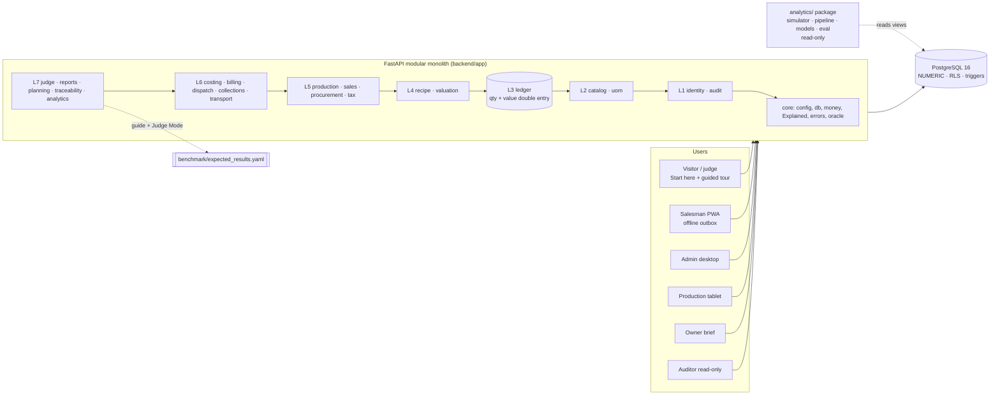

# AaharOS architecture and pipelines

*Every gram traced. Every rupee explained.* This page is the map: what lives where, which way dependencies point,
and the four pipelines that move work, code, benchmark results and data through the project.
Detailed designs (MP01): [ERD](erd.mmd) · [invariants](invariants.md) · [ledger](ledger.md) · [BOM](bom.md) ·
[open questions](open-questions.md).

## 1. System view



## 2. Repository layout

```
apps/web/                React + TS + Vite. Start-here page and guided tour today; role apps from MP06 on
  src/guide/             steps.ts (tour copy), screens.ts (screen registry), checks.ts (NIT table)
  src/lib/               format (exact-decimal display), guideData/guideStore (API data)
backend/app/core/        shared kernel (L0)
backend/app/modules/     21 business modules, one package each (owning MP in each __init__.py)
backend/tests/           backend tests (module tests live in modules/<m>/tests/)
benchmark/               oracle, 26 assertions, oracle-integrity checks, scoreboard runner
analytics/               simulator, pipeline, models, eval (MP16); never writes the ledger
docs/                    brief, master pack, ADRs, architecture, assumptions, traceability, PROGRESS
.github/workflows/ci.yml CI pipeline
Makefile                 every command (runs inside Docker)
```

## 3. Module dependency rules
- Lower layers never import upper layers. `app.core` never imports a module. Both are checked by import-linter in CI.
- Across modules, call the other module's `service.py` only; never import its `models.py`.
- `domain.py` is pure (no DB, no I/O), `mypy --strict`, 100% unit-testable.
- Posting a business event = one database transaction in the owning module's service.

## 4. Pipeline 1: delivery (how each master prompt moves)

```
read PROGRESS.md → read the MP section → plan (plan mode for MP01/02/04/06/10) → build in small steps
→ tests after each step → make benchmark (no green row turns red) → update PROGRESS.md (+ ADR if money/stock/tax/units/audit)
→ propose a conventional commit → user commits → stop
```
Gate per MP: new behaviour has tests incl. a failure path; `make benchmark` runs; no float in money paths.

## 5. Pipeline 2: CI (`.github/workflows/ci.yml`)

| Job | Steps |
|---|---|
| backend | ruff check → ruff format --check → import-linter contracts → mypy --strict → pytest |
| benchmark | scoreboard written to the job summary; fails only if a row is FAIL or the oracle was edited |
| web | npm ci → eslint + prettier → tsc → vitest → vite build |

## 6. Pipeline 3: benchmark

```
reset BENCHMARK tenant only → seed NIT §5 master data → replay the 9 steps through the real services
→ compare 26 assertions with the oracle → scoreboard (CLI: make benchmark · JSON: benchmark/results/latest.json
· web: Start-here table and tour · MP15: Judge Mode button)
```
- Status per row: GREEN (passes), RED (strict xfail, not built yet, names its MP), FAIL (ran and failed).
- `test_oracle_integrity.py` guards `inputs` + `nit_expected` with sha256 and re-derives every oracle figure in `Decimal`.

## 7. Pipeline 4: data and analytics (MP16)

```
raw (simulator / optional mandi prices) → contract-validated (pandera) → canonical units → de-duplicated
→ chronology-checked (order ≤ invoice ≤ dispatch ≤ payment) → feature tables (SKU×week, customer×week, run)
→ baselines first → models must beat baselines on a time split → planted-truth recovery report (make ml-eval)
```
Benchmark data is never training data. Analytics reads views and never writes ledger, invoice, payment or run tables.

## 8. The public guide (MP00)
- `/` Start here: what AaharOS is, the two loops, three ways to test, NIT's checks with expected values and build status.
- `/guide/:step` guided tour: intro + NIT's nine steps + finish. Each card: who, where, what to do, what you should see, why.
- A floating **Guide** button opens the same steps as a side panel on every page.
- All numbers come from `GET /api/guide/expected` (the oracle); statuses from `GET /api/guide/scoreboard`.
- When an MP builds a screen it sets `built: true` in `apps/web/src/guide/screens.ts`, and the tour's "Take me there" link goes live.
