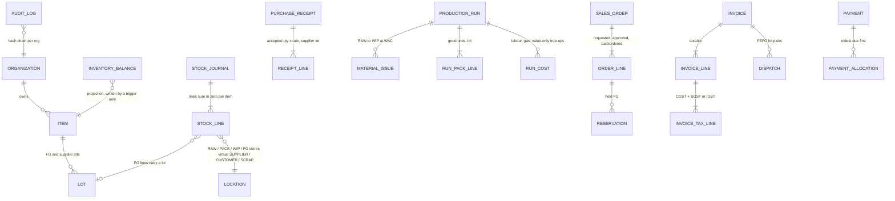

# AaharOS design note (2 pages)

**Every gram traced. Every rupee explained.** A modular monolith (FastAPI + PostgreSQL 16 + one React PWA) for a small
snack factory. Two loops meet at finished-goods stock: **sales** (order → approve → GST invoice → FEFO dispatch →
payment) and **production** (purchase → issue per BOM → run → finished goods → variance and cost).

## 1. Data model (core)

Every business row has `organization_id` and PostgreSQL row-level security; the API connects as a non-owner role, so
one tenant can never read another (the DEMO factory, benchmark factories and visitors' sandboxes share one database).

## 2. The ledger: double entry for kilograms
A stock movement is a **journal** whose lines sum to zero per item across locations, in base units (g, mL, piece)
as `NUMERIC(18,6)`, with rupee values as `NUMERIC(14,2)`. A purchase of 60 kg flour at ₹45 is `RAW_STORE +60,000 g
+₹2,700.00` / `SUPPLIER −60,000 g −₹2,700.00`. A deferred constraint trigger refuses any unbalanced journal; journals
and lines are insert-only; store balances are a projection kept by a trigger and can be rebuilt from the lines at any
time (`make integrity` compares them). A store can never go negative, and stock held for an approved order cannot be
taken by another (per-item locks; a race test proves only one approval wins).

**BOM consumption.** A run freezes a snapshot of its recipe version and pack spec version when it starts.
- Ingredients are issued RAW → WIP at the moment's WAC and compared with the frozen recipe × batches (flour 40 kg,
  oil 10 L standard vs 10.5 L actual = +5.00%, flagged above the 3% tolerance).
- At completion, WIP → FG for good packets (a new lot, best-before from the pack's shelf life). Packaging is consumed
  per **good** packet: the standard for 188 good is 188 pouches + 9.4 cartons, so 194 pouches is +3.19%.
- Yield: expected 200, good 188 = −6.00%. Damaged pouches go to SCRAP at no value. The mass balance (input mass vs good
  output + scrap + recorded loss) is reported, and an unexplained gap above tolerance is flagged, never hidden.

## 3. Valuation and costing
- **Valuation:** weighted average per item, read from the projection as a pooled (quantity, value); flour after the
  purchase is (₹4,200 + ₹2,700) / 160 kg = ₹43.125/kg. History is never revalued. FIFO and last-price values are
  replayed from history for comparison only.
- **Finished-goods lots at actual cost:** B-001 holds the issued materials (₹4,055.00). Labour ₹1,200 and gas ₹600
  arrive later as value-only true-ups spread over wherever the lot's packets are now (FG store and, once dispatched,
  cost of goods sold), so the books stay consistent after the sale. FINAL marks the run's cost closed.
- **Cost per packet** = run cost / good packets = ₹5,855.00 / 188 = ₹31.14 (stored to 6 dp, shown to paise).
- **Where profit leaks:** actual ₹5,855.00 − standard for 188 packets ₹5,423.80 = ₹431.20 unfavourable, split into
  yield loss ₹307.20, oil usage ₹70.00, flour price ₹45.00, pouch damage ₹15.00 and the rest, each an `Explained`
  value with its formula and the documents behind it.
- **Tax:** a rule engine per HSN and date (5% here): intra-state CGST + SGST, inter-state IGST, rounded half up to
  paise per line; invoice tax lines = GST summary = GSTR-1-shaped export (law 4).

## 4. Audit, immutability and reversal
- Posted documents (receipts, issues, runs, invoices, dispatches, payments) are immutable: database triggers refuse
  UPDATE and DELETE, and the app role has no DELETE. A mistake is corrected by a new document: a reversal journal
  (exactly once per journal), a credit note, an invoice cancellation before dispatch.
- Every privileged mutation writes an audit row (who, what, before / after, correlation id) whose hash includes the
  previous row's hash; `make integrity` re-walks the chain, and the month's evidence pack exports its head.
- A closed month is locked against postings; reopening needs a reason and is itself audited.
- Every computed figure the UI shows is an `Explained` value (value, unit, formula, inputs with source document ids),
  so ⓘ always leads back to rows in this database. ML and the LLM never write to the ledger.

## 5. The four conservation laws (each a property test and an integrity check)
1. **Quantity:** each journal's lines sum to zero per item. 2. **Value:** rupees into WIP or FG = rupees out of raw
stock + run costs; variances are explicit. 3. **Mass:** recipe input is reconciled with good output + scrap + loss;
gaps are shown. 4. **Tax:** invoice tax lines = GST summary = GSTR-1 export.
